<!-- ========================================================== -->
<!--            CYBER HUD SCANNER BANNER (SVG IMAGE)            -->
<!-- ========================================================== -->

  

<h3 align="center">
🚀 Software Engineering Student • Full Stack Developer • AI & Robotics Enthusiast
</h3>

  

---

# 💫 About Me

🎓 **Software Engineering Student** at **Daffodil International University (DIU)** (2024–2028)  
💻 Passionate about building **Modern Web Applications** & **Glassmorphism UI/UX**  
🤖 Exploring **Artificial Intelligence**, **Machine Learning**, & **Robotics** (Built Human-Following Robot)  
🧠 Active **Competitive Programmer** on Codeforces (157+ problems solved) & Beecrowd  
📚 Dedicated **Private Tutor** for ICT & Science students  
🏋️ Focused on continuous personal growth, fitness, and physical endurance  
🚀 Love transforming innovative ideas into functional, production-ready software  
 

---

# 🚀 Current Focus

| Area | Focus Details |
| :--- | :--- |
| ⚛️ **Frontend Development** | Building responsive web applications with **React.js** & **Glassmorphism UI** |
| 🛠️ **Backend Architecture** | Constructing robust backend services using **Node.js** & **Express.js** |
| 🗄️ **Database Design** | Working with **MongoDB** for modern database solutions |
| 🤖 **AI & Robotics** | Exploring **Machine Learning** & practical hardware prototypes |
| 📈 **Competitive Programming** | Mastering Data Structures & Algorithmic Problem Solving |

---

# 🛠️ Tech Stack & Skills

  

---

# 📊 GitHub Analytics

  

---

# 📈 Contribution Graph

  

---

<!-- FOOTER -->

  
  

